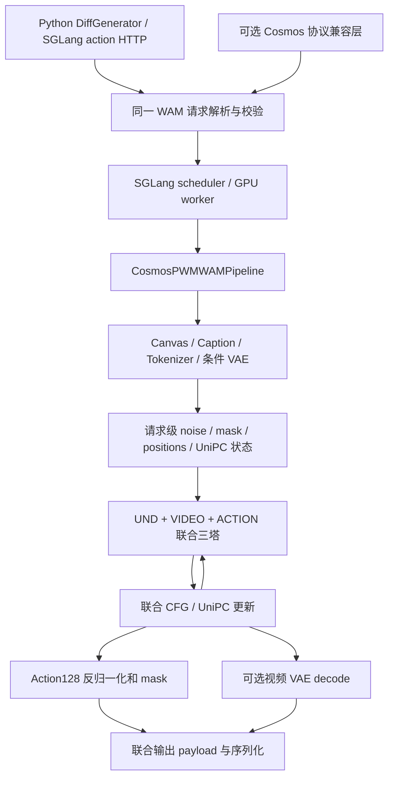

# 三塔 PWM WAM 推理接入 SGLang 的调研与实施计划

> 2026-10-29 验收补充：用户要求接入后的单 GPU/B1 WAM 推理快于同时开启 compile 和 FlashAttention 3 的 Cosmos Baseline。前期 eager SDPA 仅是对齐阶段；接下来补齐原生 FA3/compile，以同资产、输入、软件环境和计时边界的稳定态实测及输出验证验收。进度与最终证据见 record_1028.md / report_1028.md。

状态：仅调研与规划。本文是本轮唯一新增文件；没有开发模型、安装依赖、转换权重、启动服务或运行测试。下文的实施、测试与性能测量均为后续工作。

调研日期：2026-10-28（Asia/Shanghai）。

## 1. 结论与推荐路线

1. **Diffusion 和 flow-matching 推理直接实现在当前 SGLang 主仓库中。** 入口是 `sglang.multimodal_gen`，属于同一个 `sglang` Python 包；`sglang serve` / `sglang generate` 根据模型和 pipeline 选择该后端。这里与自回归 LLM 的 `sglang.srt` 是不同运行时，并不需要另外安装 Omni 才能执行 diffusion。
2. **SGLang 确实也有独立的 `sgl-project/sglang-omni` 仓库。** 本地 README 用音频服务概括它，但当前官方 Omni 已覆盖更广的多阶段模型，包括 Cosmos3。不能把“Diffusion 内置”解释成“不存在 Omni”。
3. **官方 Omni 的 Cosmos3 generation/action 本身复用主仓库的 `DiffGenerator` 和 native action 路由。** 本任务的三塔计算、采样和请求契约应先落在当前主仓库 `multimodal_gen`；以后需要聊天、reasoner 与生成交错、多服务编排时，再由 Omni 调用它。
4. **当前 SGLang Cosmos3 支持不等于支持我们的三塔 WAM。** 现有实现把 action 当作共享 GEN 塔的一类 token；我们的 Action128 WAM 有独立 ACTION blocks、宽度、时序/位置编码、domain routing 和联合采样合同，不能仅注册 checkpoint 名称或把 `wam` 改成 `policy`。
5. **优先迁移已有原生 WAM 核心，而非从头再写。** 源仓库历史文档指向同级 `vllm-omni-pwm`，本次已确认其中有原生三塔模型、请求处理、采样、VAE 兼容实现与已导出 artifact。把这些计算与合同适配到 SGLang 的 pipeline/worker/API；不把 vLLM 引擎变成 SGLang 的在线依赖。

推荐首版：**主仓库原生 `CosmosPWMWAMPipeline`，Nano + `width_only_1b`、单 GPU、单请求、BF16 网络/FP32 solver、先以 SDPA/eager 对齐、完整 WAM 联合去噪、动作及可选预测视频输出。** 这是依据当前 recipe 给出的首版范围；真实 checkpoint 由实施阶段冻结，不能用文件名推断架构或自动选择 latest。

### 1.1 本地与官方证据

本文路径前缀约定：

- `S:` = `/share-mixed/project/eai_pwm/home/hcr/repos/sglang/`
- `C:` = `/share-mixed/project/eai_pwm/home/hcr/repos/cosmos-framework-pwm/`
- `V:` = `/share-mixed/project/eai_pwm/home/hcr/repos/vllm-omni-pwm/`

| 结论 | 已核对的源码/文档 |
| --- | --- |
| Diffusion 随主仓库和 Python 包提供 | `S:README.md:21`、`:73`；`S:python/pyproject.toml:114` |
| CLI 可自动识别或显式选择 diffusion pipeline | `S:python/sglang/cli/serve.py:109`；`S:python/sglang/multimodal_gen/runtime/pipelines_core/__init__.py:49` |
| Flow-matching scheduler 已在主仓库实现 | `S:python/sglang/multimodal_gen/runtime/models/schedulers/scheduling_flow_match_euler_discrete.py:57`；`scheduling_flow_unipc_multistep.py:29` |
| 现有 Cosmos3 是 UND + GEN，action 共用 GEN layers | `S:python/sglang/multimodal_gen/runtime/models/dits/cosmos3video.py:1283`、`:1308`、`:1401` |
| 当前已有 action API 与 Python API | `S:python/sglang/multimodal_gen/runtime/entrypoints/action/api.py:197`；`runtime/entrypoints/diffusion_generator.py:482` |

官方仓库核对：

- [SGLang Omni README](https://github.com/sgl-project/sglang-omni/blob/4d45c756eee8f13d690e65cbb3807b14c3f5451e/README.md)：独立多阶段服务项目。
- [Omni Cosmos3 cookbook](https://github.com/sgl-project/sglang-omni/blob/4d45c756eee8f13d690e65cbb3807b14c3f5451e/docs/cookbook/cosmos3_nano.md) 与 [native generation stage](https://github.com/sgl-project/sglang-omni/blob/4d45c756eee8f13d690e65cbb3807b14c3f5451e/sglang_omni/native_generation/stage.py)：生成调用主 SGLang `DiffGenerator`；Omni 负责上层路由与交付。
- [Omni native media routes](https://github.com/sgl-project/sglang-omni/blob/4d45c756eee8f13d690e65cbb3807b14c3f5451e/docs/basic_usage/native_media_routes.md)：包含 native `/v1/actions/generations` 与 `/v1/actions/metadata`。
- [vLLM Omni README](https://github.com/vllm-project/vllm-omni/blob/main/README.md)：独立项目扩展 vLLM 到 diffusion、图像/视频和 action。两个生态都有 Omni，但不能据此推断底层模型实现应放在同样的仓库位置。

### 1.2 调研版本与证据边界

| 对象 | 本次状态 | 使用方式 |
| --- | --- | --- |
| SGLang | 分支 `pwm_infer`；HEAD `990ee89877f668304761d7551d803ed6b93d1673`；开始时工作区干净 | 本次接入目标 |
| Cosmos PWM | HEAD `3d2aba0fe5e293f505d7ec52cb6b2eba8cc95d06`；有既存未跟踪输出目录 | 模型语义与当前服务 reference；不改动既存文件 |
| vLLM Omni PWM | HEAD `d3e9aad33e861b69be16c4f341695e1cc12b3314`；全仓存在大量 staged 改动，所查 `pwm_wam` 核心目录无局部改动 | 迁移计算核心的候选来源；实施前按实际文件及 hash 冻结，不能把整个 checkout 当作 clean HEAD |
| 官方 SGLang Omni | 核查 snapshot `4d45c756eee8f13d690e65cbb3807b14c3f5451e` | 确认仓库职责，不作为本次运行依赖 |

历史报告中的通过结果、误差警告、吞吐和显存数字都不是本次 SGLang 的测量。本轮只查看了 artifact 的元数据及文件存在性，没有读取全部权重或重新验证 tensor 等值。

## 2. 仓库文档与 agent 工作约定

### 2.1 SGLang 文档导航

| 文档 | 对本任务的作用 |
| --- | --- |
| `S:README.md`、`python/sglang/multimodal_gen/README.md` | 主仓库边界、DiffGenerator/CLI、部署入口 |
| `S:python/sglang/multimodal_gen/.claude/CLAUDE.md` | diffusion agent 架构图与目录职责；模型部署先看 cookbook |
| `S:python/sglang/multimodal_gen/.agents/skills/sglang-diffusion-add-model/SKILL.md` | 本次采用的模型接入指南；先读 reference、检查复用，再选 pipeline 风格 |
| `S:docs/docs/sglang-diffusion/support_new_models.mdx` | config → pipeline → stages → model 的阅读顺序、代码归属、外部插件能力 |
| `S:docs/cookbook/diffusion/Cosmos/Cosmos3.mdx` | 现有 Cosmos3 能力、action 与 flow scheduler；不能直接作为 PWM 启动 recipe |
| `S:docs/README.md`、`docs/AGENTS.md` | Mintlify 文档结构；参数和行为必须查实现，模型文档与 CI 配置用途不同 |
| `S:test/README.md` | 当前测试入口是 `test/run_suite.py` / `test/registered/`，diffusion 尚有 package 内测试与注册桥接 |
| add-model skill 的 `references/testing-and-accuracy.md` | 后续 GPU case、component accuracy 和已有测试的放置方式；需结合根测试 README 解释，避免照搬过时路径 |

当前未发现 SGLang 根目录 `AGENTS.md`；重要模型接入指导在上述嵌套文档中。开发时按所触及代码加载其他 skill：写测试读 `write-sglang-test`；触及 SRT 的配置/全局状态读 `sglang-runtime-context`；移动已有代码读 `mechanical-refactor-verify`；新增 kernel 才读对应 kernel skill。本方案优先不改 SRT Scheduler/ModelRunner，也不把 SRT 配置规则机械套到 diffusion 的独立 ServerArgs。

关键设计约定：联合多模态去噪适合 **Native Task-Contract Pipeline（Style C）**。add-model skill 第 36、61、752 行明确允许自有联合状态与 denoise/decode 阶段，并要求 Python/offline 与 HTTP 共享请求校验。WAM 符合此条件，不能为套用标准单 latent `DenoisingStage` 而改变模型语义。

### 2.2 PWM 文档与既有工作

- `C:AGENTS.md`：仓库导航、引用 `file:line`、训练与推理职责分层。
- `C:.agents/skills/cosmos3-inference/SKILL.md`：默认值优先级、seed、输入 JSON 相对路径与推理入口。
- `C:docs/action_serving.md`、`docs/inference.md`：本任务的 WAM/Action128 请求与输出合同。
- `C:examples/toml/sft_config/action128_wam_nano_160gpu.toml:18`：当前三塔训练 recipe；实际加载仍以 checkpoint 保存配置为准。
- `C:plans/v0.3.0e_vllm/{plan_access,research_pwm,report_1019,report_opt_1020}.md`：已有原生 WAM 接入与优化记录。早期 plan 中的新建任务有些已经完成，应优先看最终报告和当前代码。
- `C:packages/vllm-cosmos3/README.md:6`：该插件注册的是 Reasoner，不是此次 WAM 核心；真正可复用计算代码在同级 `V:` 仓库。

## 3. 模型与参考执行链

### 3.1 三塔结构

当前 `width_only_1b` preset：

| 塔 | 层数 / hidden | Attention 几何 | 说明 |
| --- | --- | --- | --- |
| UND | 36 / 4096 | 32 Q heads、8 KV heads、head dim 128 | 理解/条件 token 路径 |
| VIDEO | 36 / 4096 | 与 dense Nano backbone 对应 | 视频 flow-matching 路径 |
| ACTION | 36 / 1280；MLP intermediate 3840 | 仍为 32 Q / 8 KV / 128 | 独立 norm、QKV/O、MLP、time/modality embedding 与 128 维 domain projection |

ACTION 的 hidden 1280 不等于 Q 投影总宽度；不能按普通 Transformer 的 `hidden / heads` 推导 head dim。依据：`C:cosmos_framework/model/generator/mot/small_action_tower.py:30`、`:60`、`:92`；`cosmos3_vfm_network.py:309`。

同一样本内的 attention 可见性：UND query 仅看 causal UND；VIDEO 与 ACTION query 均可看 UND + VIDEO + ACTION。每层三路 QKV 来自该层更新前状态，随后分别更新，必须保留同步关系。依据：`small_action_tower.py:199`、`:321`。因此三塔是一个联合模型执行单元，不能拆成三个互相独立的推理服务。

### 3.2 当前 Cosmos 服务作为语义 reference

```text
scripts/action128_server.py
  → inference/action_server.py：加载固定 checkpoint、创建服务
  → OmniSampleOverrides(model_mode="wam")
  → action_serving.prepare_wam_request / assemble_batch
  → OmniMoTModel.generate_samples_from_batch
  → VIDEO + ACTION 联合 flow/UniPC/CFG
  → Action128 source 反归一化、mask、时间戳
  → SampleOutputs（action + 可选 vision.mp4）
```

依据：`C:cosmos_framework/inference/action_server.py:257`、`:291`、`:432`；`action_serving.py:224`；`model/generator/omni_mot_model.py:3255`。

原服务单副本串行执行，忙时拒绝；多卡方式主要是 FSDP 权重分片，不能直接宣称转换成 SGLang TP/SP。三塔当前还明确约束 CP=1 等条件（`omni_mot_model.py:299`；`cosmos3_vfm_network.py:1396`）。

### 3.3 已存在、应优先复用的原生实现

已确认 `V:vllm_omni/diffusion/models/pwm_wam/` 存在以下模块：

| 现有模块/产物 | SGLang 中的复用目标 | 迁移时需要处理 |
| --- | --- | --- |
| `transformer_pwm_wam.py` | 三塔计算与严格权重树 | 去除后端 provider 耦合；先保留已知数值语义 |
| `request.py`、`positions.py` | Action128 校验、caption、时间/空间位置与 packing | 复用纯数据/张量部分，适配 SGLang 请求类型 |
| `runtime.py` | 条件编码、噪声、联合采样与输出 | 将生命周期接入 SGLang stages；替换 vLLM 导入，不保留 vLLM engine |
| `vae.py` | Wan VAE 兼容处理 | 保留 checkpoint RMS 算术，确认 SGLang VAE 是否等价 |
| `pipeline_pwm_wam_native.py`、`serving.py` | engine 与 wire 接线参考 | 用 SGLang pipeline/worker/API 重新接线，不整体搬旧服务框架 |
| `artifacts/pwm-wam-hf/` | 第一份候选回归 artifact | 现有 config/index/7 个 safetensors 分片及 export manifest；目标 checkpoint 仍待冻结 |
| `tools/pwm_wam/` 与历史 validation artifact | 导出、fixture、对照工具的候选复用 | 按内容与版本检查后使用；历史结论不自动继承 |

`transformer_pwm_wam.py:439` 的 loader 读取现有 HF 原生权重树，移除 `model.net.` 前缀后严格比对 required keys（`:471`）。历史报告记载 iter_000008600 的 1214 tensor 审计，但本轮没有重做该审计。

迁移时必须剥离的框架耦合包括：`DiffusionRequestBatch` / `OmniDiffusionConfig` / `DiffusionOutput`、vLLM distributed groups、`vllm.vllm_flash_attn` provider 和 `vllm_omni::` custom-op namespace。首版采用现有纯 PyTorch SDPA 分支，不迁移旧 subprocess bridge `pipeline_pwm_wam.py` / `worker.py`。已有 native 的 CFG/SP/TP、Graph、FP8 与 batching 实验代码可留作后续参考，不能视为 SGLang 已有支持。

**保留现有 artifact 格式。** 历史接入记录明确指出向原 artifact 根加入 `model_index.json` 会误触发 Diffusers loader；本次优先用 SGLang 显式 pipeline class、自定义 `load_modules()` 和现有 config。若需新的 SGLang manifest，使用独立 wrapper/sidecar，不原地改变共享 artifact 的识别方式。参考 `V:tools/pwm_wam/README.md:10`、`C:plans/v0.3.0e_vllm/report_1019.md:13`。

### 3.4 已定位的版本差异：复用前必须补齐

已有 native 的来源早于当前 Cosmos HEAD，存在以下已核实差异。迁移目标以冻结后的当前 Cosmos WAM 合同为准，旧 native 用于复用计算和定位分歧，不能直接充当所有行为的正确性标准。

| 差异 | 当前证据 | 后续处理 |
| --- | --- | --- |
| Inactive action 槽在采样过程中未屏蔽 | `V:.../pwm_wam/runtime.py:265` 对全部 128 槽加噪声；输入/velocity 未应用请求 mask，只在 `:474` 最终清零。当前 `C:.../omni_mot_model.py:2458`、`:2673` 已在计算过程中约束这些槽 | P2 补齐初始噪声、网络输入、velocity/条件回填的 mask，重建 reference；可能改变 active 动作与视频，不能只验最终无效槽为零 |
| 原 native 只读取本地图片与直接 prompt | `V:.../pwm_wam/request.py:102` 用 `PIL.Image.open()`；`:151` 要求直接 prompt | 入队适配层处理 URL、本地视频首帧和 `prompt_path`，再走统一 canvas/caption 流程；复用 SGLang 媒体 I/O，保持原路径语义 |
| 缺省 seed 不同 | 旧 native `request.py:148` 默认 0；当前 Cosmos `action_serving.py:242` 生成 seed 并回显 | 共用入口解析缺省 seed，解析后固定传入 worker；Python/HTTP 保持一致 |

测试计划加入省略 seed、视频观测、URL、prompt_path 和非连续 mask 的回归。历史 artifact 可先验证加载与权重树；旧 native 的输出基线需要按上述差异重新建立。

## 4. 必须保持的 WAM 请求、计算与输出合同

### 4.1 输入和时间几何

规范请求仍以 `model_mode="wam"`、`prompt`、`vision_path`、采样参数和 `extra.action128` 表达；SGLang API 名称映射应显式完成，而不是让通用默认值接管。

| 合同 | 需要保留的行为 |
| --- | --- |
| 观测 | 图像或视频第一帧；多相机由客户端拼接为真实 canvas；首版无 state/history |
| action domain | 完整 source domain；projection domain 与 normalization domain 分开解析 |
| `action_dim_mask` | 恰好 128 个 bool，至少一个有效，允许非连续槽；不能用 normalization mask 或“前 N 维”代替 |
| 相机/空间 | `selected_roles`、真实 `camera_layout`、resize 与黑缝几何、`action128_seam` 位置编码一致 |
| Caption | 复用实际 render/JSON prompt 合并规则；包含训练约定的 embodiment、时长、频率、分辨率和 layout 信息 |
| 时间 | 动作频率与视频 FPS 独立，动作时间戳从 0 起，`action_start_frame_offset=0` |
| Horizon | 动作步数 T，窗口 `duration=T/action_fps`，当前 recipe ≤2 秒，视频 FPS≤30 |
| 帧数 | `4 * ceil(ceil(duration * fps - 1e-8) / 4) + 1`；显式帧数必须匹配，不套现有 Cosmos action 的 `T+1` 通用假设 |
| 默认值 | HTTP WAM 的 steps/guidance/shift 为 **30 / 1.0 / 10.0**；其他字段沿用原请求解析优先级 |
| 首版范围 | 一个输入、一个输出，无 sound、prompt upsampling 或额外条件帧 |

例如 20Hz 动作/20FPS 视频/2 秒：40×128 动作、41 帧视频；50Hz 动作/15FPS 视频/2 秒：100×128 动作、33 帧视频。

依据：`C:cosmos_framework/inference/action_serving.py:165`、`:224`、`:284`、`:295`；`inference/defaults/wam/sample_args.json:2`；`docs/action_serving.md:257`。原 JSON 文件相对路径按 JSON 所在目录解析，HTTP 相对路径按服务工作目录解析；适配时保留并说明，不暗中更换基准目录。

### 4.2 数值合同与已知迁移修复

1. VIDEO/ACTION 噪声与 solver 累积为 FP32，网络边界使用 BF16。两模态按 reference 的 seed 映射分别产生噪声；同 seed 不足以证明同初始状态，应能比较实际初始 tensor。
2. 维持联合 `[vision | action]` 展平顺序、condition mask 和条件回填；inactive action 槽在噪声、模型输入、velocity 和最终输出均按 reference 清零。
3. 每请求独享 UniPC 历史、CFG 状态、latent 和 cond/uncond 状态。CFG 是 `u + guidance * (c-u)`；`normalize_cfg` 作用于联合向量，不能分别归一化视频和动作。
4. **不能直接替换成 SGLang 的同名 UniPC。** 已有原生实现 `V:.../pwm_wam/runtime.py:305` 使用 `use_cpu_coefficients=True` 和 `use_legacy_corrector=True`，对应旧环境的系数/舍入兼容；当前 SGLang 同名 scheduler 没有这两个选项。迁移时保留该兼容算法，或以逐步等值证据证明替换成立。
5. **不能默认任意 Wan VAE 等价。** `V:.../pwm_wam/vae.py:11` 保留 checkpoint 的 BF16 RMS 行为，避免版本变化的 FP32 upcast 改变条件 latent。核对权重、RMS、latent mean/std、时空压缩、padding/patch 顺序及 encode/decode 精度后才复用 SGLang VAE。
6. 第一阶段保留清楚可对照的未缓存路径。已有 native UND cache 保存 raw K projection，并在消费时重新 norm/RoPE（`transformer_pwm_wam.py:291`）；若迁移缓存，必须保留这一修复，cond/uncond 分开，覆盖位置与请求隔离。clean 首帧不表示其 VIDEO KV 可跨 step 固定。

源数值依据：`C:cosmos_framework/model/generator/omni_mot_model.py:2500`、`:2623`、`:2805`、`:3677`；`cosmos_framework/model/generator/diffusion/samplers/unipc.py:66`。既有原生代码中的修复属于候选复用内容，不能在“清理代码”时无证据删除。

### 4.3 输出

- 动作返回 `[T,128]` FP32 source/physical units，并能取得 normalized actions、mask、domain、action FPS、时间戳、seed 与 checkpoint/contract 标识。
- 仅 normalization mask 选择的槽执行 `(normalized - bias) / scale`，其余保留来源单位；随后应用调用方 slot mask。不得额外套旧 DROID/Libero 的坐标或 gripper 变换。
- `return_video=false` 仅跳过最终 VAE decode/文件保存，**仍执行未来 VIDEO latent 与 ACTION 联合去噪**。
- `return_video=true` 返回与动作同一次 rollout 的预测视频；不能用输入图像复制、独立另跑视频或仅回动作代替 WAM 输出。
- Cosmos 兼容输出保持 `SampleOutputs.outputs[0].content.action`、`content.action128`、`files`；SGLang 原生 action envelope 通过明确附件表达视频，见下一节。

依据：`C:cosmos_framework/inference/action_server.py:303`、`:334`；`model/generator/mot/action128.py:103`、`:133`；`docs/action_serving.md:295`。

## 5. SGLang 接入设计

### 5.1 执行路径



以 `ComposedPipelineBase` 接入，阶段保持 preprocessing、联合 denoise、action postprocess、可选 video decode 的职责。不可变权重由 pipeline/组件持有；请求数据在 typed request state 中，通过 `Req.extra` 等现有扩展点传递，不存为 pipeline 的共享可变字段（`S:runtime/pipelines_core/composed_pipeline_base.py:114`、`schedule_batch.py:209`，均位于 `python/sglang/multimodal_gen/`）。

迁移时特别处理现有 native runtime 的 `_pending_und`、`last_approx_report` 等请求状态，以及 TF32/cuDNN 的进程全局设置（`V:.../pwm_wam/runtime.py:62`）：请求字段移入请求上下文，精度策略在 SGLang worker 明确初始化，不在模块导入时改变其他模型的行为。

首版显式关闭 dynamic batching、disaggregation、未经验证的 TP/SP/CFG parallel、跨请求特征缓存、量化、CUDA Graph。若用户选择不支持的组合，启动或入队前明确报错。配置开关参考 `configs/pipeline_configs/base.py:462`、`:476`。不承诺单卡覆盖所有分辨率，显存容量作为后续实测项。

### 5.2 注册与加载

- 独立 `pipeline_name` / `EntryClass`，对应独立 pipeline config 和 sampling params；优先显式 `--pipeline-class-name CosmosPWMWAMPipeline`。这是拟议名称，目前不能执行。
- 按实际 artifact schema 精确识别，不增加宽泛 `"cosmos" in path` detector，不覆盖已有 Cosmos3 registry。
- 自定义 `load_modules()` 读取现有 native artifact；`Pi05Pipeline` 已提供无固定 Diffusers module list 的先例（`S:.../runtime/pipelines/pi05.py:30`、`:44`）。组件若能复用则通过已有 loader 接口接入。
- 在线 worker 不读取 trainer/optimizer、不直接 import 完整 `OmniMoTModel`，也不启动旧 Cosmos 子进程。原服务只作为独立环境 reference。
- 外部插件 `register_pipeline()` / `SGLANG_EXTERNAL_MODEL_PACKAGE` 已存在，可用于将来独立分发；本任务默认直接在当前仓库开发，无需为此另建 Omni 仓库。

### 5.3 动作 API 与联合输出：必须改到的边界

复用 `/v1/actions/generations`、`/v1/actions/metadata` 与 `DiffGenerator.generate_action()`。现有 action API 是 SGLang 扩展，不将其描述为标准 OpenAI action 协议。

现有三个限制已经核对：

1. `runtime/entrypoints/action/protocol.py:452` 只走通用 `ActionSamplingParams` 白名单或 Cosmos3 特判；仅给 sampling dataclass 添加字段不能保证 WAM 参数传入。增加范围明确的 WAM adapter/model-owned builder，让 Python 与 HTTP 共用解析函数。
2. `runtime/entrypoints/action/cosmos3.py:136` 仅支持 policy/inverse dynamics；`stages/model_specific_stages/cosmos3.py:2570` 的 ACTION 分支在视频 decode 前返回。因此 WAM 不能直接复用该 ACTION 分支。
3. `DiffGenerator.generate_action():508` 和 `protocol.infer_action():486` 只返回 `OutputBatch.output[0]`；`protocol.action_generation_response():489` 重建只含动作及少数元数据的 envelope，视频字段会被丢弃。raw response 也仅专门转换 actions ndarray。

拟议输出策略：用一个 typed WAM payload 装载 `actions`、Action128 元数据及可选 `video` 附件，在 `OutputBatch.output[0]` 中贯穿；为既有 action envelope 增加向后兼容的可选附件字段。HTTP 视频走文件 ID/可下载 URL，明确文件存活期和清理；Python 可按请求返回 CPU frames 或路径。不要把大 GPU tensor 直接塞 JSON，也不要仅设置 `action_pred`/`output_file_paths` 后假设现有入口会保留。

如需原 Cosmos 客户端直接使用，增加薄兼容层，将 `/generate` 请求和 `SampleOutputs` 映射到同一个 SGLang worker；不复制模型执行，也不新建 `/predict`。先检查 `/models` 等既有路由的冲突；兼容层可使用独立入口承载原协议。首版先打通原生 API，再完成该兼容映射。

## 6. 推理产物与环境

### 6.1 优先复用产物，按目标 checkpoint 补齐

先审查 `V:artifacts/pwm-wam-hf/` 的 config、manifest、权重索引、Action128 buffers 与 tokenizer/VAE 引用，冻结可复现的基线。若业务选择当前训练的新 checkpoint，先核实并复用 `C:cosmos_framework/scripts/export_model.py` 的原生 HF 导出路径，只补确有缺失的 metadata。当前未发现专用 `export_pwm_wam.py`，但已有原生 HF artifact；“普通 Diffusers converter 不覆盖第三塔”不等于“现有导出基础不能导出三塔”。

推理产物至少需要：

- 三塔结构、36 层映射及各维度、独立 ACTION time/modality/final norm、全部模型权重及 shard index。
- `tower_structure`、preset、execution、seam/temporal position、projection routing 等保存配置。
- source registry、projection 与 normalization 两套 ID、FP32 normalization buffers、normalization mask、contract fingerprint/digest。
- 兼容 tokenizer/template、Wan VAE 权重和配置，或显式且可验证的本地引用。
- WAM 默认值与 UniPC 兼容参数；schema、源代码与导出代码 revision、明确 checkpoint iter、文件/tensor 审计信息。

如果必须读 DCP，沿用原服务对 `config.yaml`、`.metadata`、分片、`.save_complete` / `latest_checkpoint.txt` 的完成性判断；启动固定一个 snapshot，不扫描最大的目录，不在请求间切换权重。导出写入独立目录，保留现有 artifact。

加载审计必须检查 missing/unexpected/duplicate keys、shape、dtype、元素数、映射后的数值；不可用 `strict=False` 静默丢掉 ACTION blocks/normalizer。已有普通 Cosmos Diffusers converter 构造共享 GEN 模型，不作为三塔正确性证明（`C:cosmos_framework/scripts/_convert_model_to_diffusers.py:1486`）。

### 6.2 环境不能直接混装

| 项目 | SGLang 当前声明 | Cosmos PWM 当前声明 |
| --- | --- | --- |
| PyTorch | `2.14.1` | 环境组包含 `2.10` / `2.13` 及不同 CUDA/FA3 构建 |
| Transformers | `5.19.0` | `>=4.57.1,<5.0.0` |
| Diffusers | diffusion extra 固定 `0.37.0` | `>=0.39.0` |

依据：`S:python/pyproject.toml:5`、`:90`、`:96`、`:119`；`C:pyproject.toml:29`、`:44`、`:168`、`:238`。这些是仓库依赖声明，不是本轮已安装环境探测。

保持 reference/export 与 SGLang inference 环境分离。优先移植纯 PyTorch 核心，显式替换 scheduler/provider/VAE 兼容边界；不靠 `pip install --no-deps` 把整个训练框架强塞到服务环境。迁移代码保留源 SPDX/归属：源 Cosmos 声明 OpenMDW-1.1，不能因目标仓库使用 Apache-2.0 就直接改写来源文件许可。

## 7. 后续实施阶段与交付物

以下工作尚未开始。每阶段产物都可以独立 review；不以模型名被 registry 识别作为“接入完成”。

| 阶段 | 工作与交付物 | 进入下一阶段的条件 |
| --- | --- | --- |
| P0：冻结范围与可复用基线 | 固定三仓库代码文件/hash、目标 checkpoint、artifact schema、GPU/显存、请求集与依赖组合；盘点已有 native 修复、优化开关及 §3.4 版本差异 | 明确哪些代码/资产复用、哪些需适配；不依赖未定位的旧路径或历史性能结论 |
| P1：产物加载与纯推理组件 | 适配现有 native loader；补齐必要 exporter/metadata；隔离 SGLang 配置与三塔组件 | 完整权重对账；domain/normalizer/tokenizer/VAE 可解析；错误 schema/shape 被拒绝 |
| P2：请求、三塔与采样移植 | 共用 WAM contract；补齐过程 mask、媒体/prompt/seed 差异；迁移 preprocessing/positions、三塔模型、兼容 UniPC/VAE；保留易诊断路径 | 相同固定输入的离散中间量一致；单步 VIDEO/ACTION velocity 与全采样轨迹有可解释对照 |
| P3：SGLang pipeline 与 Python | 注册 pipeline/config/sampling；使用 SGLang worker 执行；请求状态隔离；`generate_action()` 返回联合 payload | 单 GPU/B1 原生执行完整请求；两种 return_video 行为正确，无 Cosmos/vLLM worker 在线调用 |
| P4：HTTP 与兼容协议 | WAM action builder、metadata、视频附件序列化/下载/清理；必要的 Cosmos `/generate` 薄映射 | Python/HTTP/兼容层同请求同语义；动作单位、视频、seed/domain 信息无丢失 |
| P5：回归、文档与运行基线 | 数值/视频联合验证、错误与隔离验证、现有 Cosmos/Pi05 action 回归、部署文档 | 首版范围内验收材料齐全，未支持组合明确拒绝；无未经测量的提速声明 |
| P6：单独优化 | 逐项引入已有 FA3/compile/metadata/UND cache，再选择 batching/graph/并行/量化 | 每项都有独立正确性和相同条件的性能证据，不把旧优化收益重复记为 SGLang 收益 |

P1 与 P2 的合同工作可并行；P3 依赖可加载组件和稳定请求状态；P4 依赖联合输出载体。P6 不阻塞首版原生接入，但部署性能比较必须使用当前已优化的 Cosmos/native 基线，不能只比 eager SDPA。

## 8. 预计代码落点

以下为拟议文件/改动范围，不代表文件已创建。目录继续遵守当前 SGLang ownership；先复用已有模块，避免复制整棵 vLLM/Cosmos runtime。

| 路径（相对 `S:python/sglang/multimodal_gen/`） | 责任 |
| --- | --- |
| `configs/pipeline_configs/cosmos_pwm_wam.py` | 模型选择、首版能力限制、artifact/精度配置及 action metadata |
| `configs/sample/cosmos_pwm_wam.py` | 统一采样字段、WAM defaults 和合同校验入口 |
| `runtime/pipelines/cosmos_pwm_wam.py` | `CosmosPWMWAMPipeline`、加载、stage 接线与 `EntryClass` |
| `runtime/models/dits/cosmos_pwm_wam/` | 从现有 native 三塔实现迁入模型、权重映射、架构专有 position/domain 逻辑；模块数量按实际职责确定，由自定义 loader 直接加载 |
| `runtime/pipelines_core/stages/model_specific_stages/cosmos_pwm_wam/` | 输入准备、联合采样、动作后处理、视频 decode；不把所有 serving 工具塞进 model 包 |
| `runtime/models/schedulers/` 下已有或专用实现 | 保留 UniPC coefficient/corrector 兼容路径；只在需要时增加专用 scheduler |
| `runtime/entrypoints/action/cosmos_pwm_wam.py` | 模型专属 HTTP adapter、metadata 与原合同映射 |
| `runtime/entrypoints/action/protocol.py` | 最小 builder 扩展和可选联合输出附件，保持已有 action 模型行为 |
| `registry.py` 及必要 loader registry | 精确注册与模型识别 |
| 现有 VAE 组件或局部模型适配 | RMS/latent/精度等兼容，不全局 monkey-patch 其他模型 |

组件注册器只扫描 component 目录第一层 `.py`（`runtime/models/registry.py:60`），不会递归发现上述嵌套包；若需要通用组件自动注册，增加顶层入口文件/显式注册，不能仅在子包放 `EntryClass`。pipeline 顶层文件的自动发现与组件发现是两件事。

配套工作：优先扩展现有 `test/unit/test_cosmos3.py`、`test_pi05_action_api.py`、`test_registry.py` 相应公共回归，再为 WAM 特有行为增加针对性测试；GPU 用例遵循当前 diffusion case/注册桥接。私有 checkpoint 的重测放手动验证，不加入无法获取资产的公共 PR CI。部署文档拟放 `S:docs/cookbook/diffusion/Cosmos/`，按 docs agent 指南接导航；不要覆盖普通 Cosmos3 的现有 recipe。

若复用 exporter 需要改 `V:` 或 `C:`，另行明确该文件的归属与改动范围；本轮没有改动这两个仓库。优先让 SGLang 消费现有 artifact，使模型迁移和导出工具维护可分开 review。

## 9. 后续验证与验收标准

**本节只列计划，没有执行其中任何测试。**

| 层次 | 重点检查 | 判定原则 |
| --- | --- | --- |
| 静态合同/加载 | 配置、全量 tensor 映射、domain ID、normalizer digest、mask、token IDs、layout、时间戳 | 离散合同与无变换导出权重精确一致；错误显式失败 |
| 前处理 | canvas resize/黑缝、caption、tokenizer、VAE latent、packing、RoPE、初始 noise | 对同一 checkpoint/request 比较实际中间量，不只看最终动作 |
| 单步网络 | 固定 noisy VIDEO/ACTION、同 timestep/CFG，比较两模态 velocity | 先定位首次分歧的层/算子，再判断完整轨迹；保留未缓存诊断路径 |
| 全轨迹 | 联合 UniPC 每步 latent/条件回填、active action、physical action、可选 decoded video | 浮点容差依据重复性、dtype/backend 和任务单位预先确定；不照搬旧报告门槛或为通过而放宽 |
| 服务 | Python/HTTP/原协议映射、视频可下载、return_video=false 仍联合去噪 | 同一次 rollout 的动作与视频完整交付，错误字段不被静默吞掉 |
| 状态隔离 | A/B/A 请求（不同 domain、shape、caption、seed），异常后下一请求 | 无 scheduler history、latent、cond/uncond 或缓存串扰；可恢复输入错误不污染后续请求 |
| 回归 | 普通 Cosmos3 policy/video、Pi05 action envelope、registry | 原有接口和模型语义保持兼容 |

请求集覆盖：单/双/三相机 canvas、不同 caption 长度、多个 source domain（包括共享 projection 但统计不同的情况）、非连续 mask、独立视频/动作频率、短/2 秒 horizon、guidance=1 与 >1、固定 seed/换 seed、开关视频。先选代表性小集合完成对齐，再扩大质量矩阵。

历史 native 报告存在 BF16 数值警告以及 FP32 诊断记录，应转成回归案例。跨版本/后端不预设 bitwise 一致，但必须报告完整动作误差、重复性、视频质量及影响范围，不能用“视频看起来正常”替代动作数值验证。

性能报告区分：加载/冷启动、warmup、动作 ready、联合采样、VAE decode、MP4 编码与 HTTP end-to-end；同时记录峰值显存、GPU 型号、版本、shape、steps、CFG、return_video 和优化开关。同 GPU 做配对重复，对照当前 Cosmos FA3+compile+metadata 路径和已存在 native 核心；若测 framework 开销，固定相同计算实现。无需预先承诺加速比例。

首版完成条件：指定真实 checkpoint 能由 **SGLang worker 原生执行三塔 WAM**，正确返回 source-unit 动作及可选预测视频；加载/合同/轨迹/服务隔离证据完整；依赖可复现；文档描述实际支持范围。注册成功、旧服务 HTTP 转发、仅视频生成或仅跑 Reasoner 均不满足该完成条件。

## 10. 开发前需要冻结的信息与当前假设

这些信息不妨碍本轮完成计划，也不在本轮启动验证：

1. **目标 checkpoint**：是否先以现有 iter_000008600 artifact 做迁移回归，还是使用新训练 snapshot？当前不自动选 latest；旧 artifact 的 source revision 与当前 `C:` HEAD 不同。
2. **模型范围**：暂以当前 `three_tower + width_only_1b + native + Action128 no-state` 为首版；若目标使用其他 preset，先补差异清单。
3. **硬件与资源**：实施节点、GPU/显存及允许使用的卡；本轮未探测或占用 GPU，不能保证最大画布单卡可运行。
4. **业务接口**：建议同时提供 SGLang 原生 action API 和薄 Cosmos 兼容映射；若只需 Python/offline，可调整 P4 优先级，核心联合合同不变。
5. **性能/质量目标**：动作 horizon、常用 shape、steps/CFG、是否默认回视频、延迟/并发与动作单位容差；未指定前不以改变采样参数换取速度。
6. **复用版本**：冻结 `V:` 相关文件的内容与依赖，隔离其现有 staged 改动；迁移既有数学修复，优化默认值另行验证。

下一步应从 P0 的版本、产物和合同冻结开始；本轮到此为止，只交付本计划。
